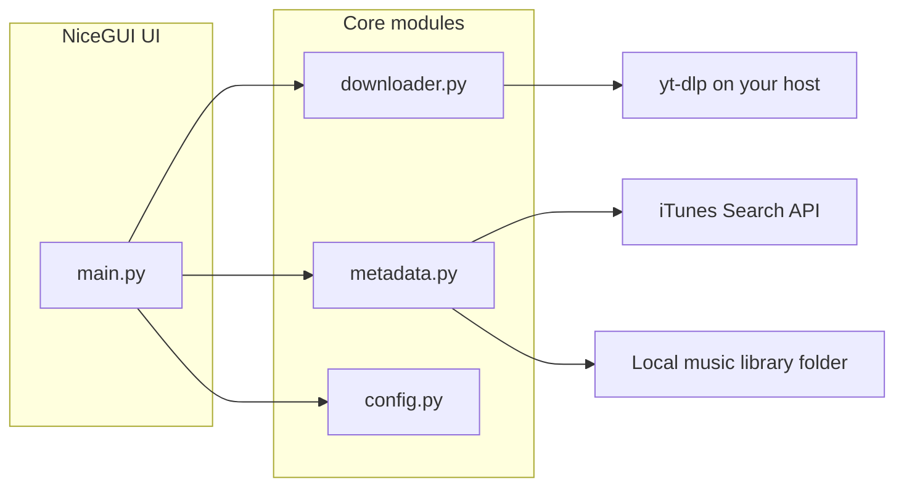

# LuwefyDL

[](https://github.com/CattF-LDaman/LuwefyDL/actions/workflows/ci.yml)


**YouTube → tagged library pipeline** — a local web UI to find audio on YouTube (search or paste a URL), pull audio via [yt-dlp](https://github.com/yt-dlp/yt-dlp), enrich metadata (manual edits or iTunes Search API), embed cover art, and save under `Artist/Album/` for self-hosted libraries such as [Navidrome](https://www.navidrome.org/).

**Author:** [luwe.be](https://luwe.be) · portfolio / educational project, not a commercial product

> **Important:** LuwefyDL is **not** affiliated with YouTube, Google, or Apple. Retrieving media from online platforms may violate those platforms’ terms and copyright law. **You are solely responsible** for how you use this software. See **[DISCLAIMER.md](DISCLAIMER.md)** — if you do not agree, do not use it.

## Features

- **YouTube search** and **direct link** input in the UI
- **Audio extraction** through yt-dlp (bundled as a Python dependency; runs on your machine)
- **iTunes Search API** for metadata and artwork, with full manual override
- **YouTube thumbnail** as optional cover art
- **ID3 / MP4** tag embedding (MP3, M4A)
- **Artist/Album** folder layout on disk
- **Library tab** — browse your on-disk library, edit tags (files move/rename to match), delete tracks with a confirmation dialog
- Dark-themed [NiceGUI](https://nicegui.io/) interface

The author does **not** operate YouTube, host downloads, or guarantee that your use is allowed by YouTube or copyright law — see **[DISCLAIMER.md](DISCLAIMER.md)**.

## Architecture



## Quick start (Docker)

Requirements: Docker and Docker Compose. Use only with content you have the right to store.

```bash
git clone https://github.com/CattF-LDaman/LuwefyDL.git
cd LuwefyDL
mkdir -p data/music temp
cp .env.example .env   # optional overrides
docker compose up --build
```

Open [http://localhost:8080](http://localhost:8080). Files you choose to process are written under `./data/music` on the host.

To use a library folder anywhere on the host, set in `.env`:

```bash
MUSIC_HOST_PATH=/absolute/path/to/your/music
MUSIC_LIBRARY_PATH=/data/music   # in-container path (default; keep unless you change both sides of the mount)
```

If saves fail with **Permission denied**, set `PUID` and `PGID` to your host user (`id -u` / `id -g`) and recreate the container. The entrypoint creates and `chown`s the bind-mounted library and temp paths from `MUSIC_LIBRARY_PATH` and `TEMP_DIR`.

## Local development

```bash
python -m venv .venv
source .venv/bin/activate
pip install -r requirements.txt -r requirements-dev.txt
python -m music_importer.main
```

Install **ffmpeg** on the host if you use audio conversion features that depend on it.

### Tests and coverage

Core modules (`config`, `downloader`, `metadata`) are covered by unit tests. The NiceGUI layer is exercised manually.

```bash
pytest --cov=music_importer --cov-report=term-missing
```

Coverage threshold (85%) applies to core modules; `main.py` is excluded from the gate.

## Configuration

| Variable | Default (local) | Default (Docker) | Description |
|----------|-----------------|------------------|-------------|
| `MUSIC_LIBRARY_PATH` | `./data/music` | `/data/music` (override in `.env`) | Library root **inside** the container |
| `MUSIC_HOST_PATH` | — | `./data/music` (Compose only) | Host path bind-mounted to `MUSIC_LIBRARY_PATH` |
| `TEMP_DIR` | `./temp` | `/app/temp` | Processing scratch space **inside** the container |
| `TEMP_HOST_PATH` | — | `./temp` (Compose only) | Host path bind-mounted to `TEMP_DIR` |
| `HOST` | `127.0.0.1` | `0.0.0.0` | Web bind address |
| `PORT` | `8080` | `8080` | Web port |
| `SHOW_BROWSER` | `true` | `false` | Open browser on startup |
| `LOG_LEVEL` | `INFO` | `INFO` | Logging verbosity |
| `DOCKER` | unset | `1` (in image) | Enables container-oriented defaults |

See [.env.example](.env.example) for a copy-paste template.

## Screenshots

Add UI captures under [`docs/screenshots/`](docs/screenshots/) for your portfolio listing.

## Legal

Full terms: **[DISCLAIMER.md](DISCLAIMER.md)**.

Summary:

- **No affiliation** with YouTube, Google, Apple, or Navidrome.
- **No legal advice** — consult applicable law and platform terms in your jurisdiction.
- **No liability** — authors and contributors are not responsible for your use, including ToS violations or account actions (e.g. YouTube restrictions).
- Use only with **content you have rights to** use, copy, and store.

## License

Software license: [MIT](LICENSE). Using LuwefyDL does not grant any rights to third-party content or services.
